# Hourly Electricity-Demand Forecasting for Bangladesh

**A comparative, time-ordered evaluation of statistical, machine-learning, and neural-network forecasting models**

## Abstract

This project develops and evaluates hourly electricity-demand forecasts for Bangladesh by integrating national electricity-system observations with division-level meteorological data. The study compares an exogenous StatsForecast AutoARIMA model, Gradient Boosting, XGBoost, and a residual artificial neural network (ANN). Predictor variables include cyclic hour-of-day indicators, mean temperature, mean wind speed, and demand lags of one and 23 rows. Model performance is assessed using three chronological six-month holdout periods rather than random train-test sampling.

Across the final saved results, the ANN achieved the lowest MAE in all three experiments: 185.881 MW for 2023, 170.954 MW for 2024, and 167.569 MW for 2025. The corresponding RMSE values were 312.974 MW, 248.446 MW, and 239.127 MW, while R² ranged from 0.9792 to 0.9884. Results should be interpreted as period-specific out-of-sample estimates. They demonstrate performance on the available data and do not establish causal relationships or guarantee future forecasting accuracy.

**Keywords:** electricity demand; time-series forecasting; Bangladesh; load shedding; weather variables; AutoARIMA; XGBoost; gradient boosting; artificial neural network

---

## 1. Research Objective

The principal objective is to forecast national hourly electricity demand using information available at forecast time:

1. combine national demand and load-shedding observations with hourly weather observations;
2. construct a chronology-aware feature matrix containing cyclic time indicators, weather summaries, and historical demand lags;
3. tune candidate model configurations using time-ordered data;
4. evaluate all models on three cumulative chronological holdout periods;
5. preserve trained estimators and preprocessing objects for reuse and interactive forecasting.

The target variable is `demand_mw`, and the analysis distinguishes recorded demand from latent unconstrained demand. Because load shedding may constrain observed consumption, `load_shedding` is retained for diagnostics and is not used as a forecast predictor.

---

## 2. Data Sources and Study Period

### 2.1 Electricity-system data

The EDA notebook describes the electricity-system source as a Mendeley dataset containing hourly PGCB-derived generation, demand, load-shedding, and fuel-mix observations. The raw PGCB file used by the checked-in workflow is `pgcb_V1_raw.csv`, but that file is stored outside this project directory and is not redistributed here.

### 2.2 Weather data

Hourly weather observations were obtained for Dhaka, Chattogram, Rajshahi, Khulna, Sylhet, and Barishal through Meteostat for 2020-01-01 through 2025-12-31. For each timestamp, temperature and wind speed were averaged across the six available regional series. The resulting variables are `temp_mean` and `wspd_mean`.

| Location | Meteostat station |
|---|---:|
| Dhaka | 41923 |
| Chattogram | 41978 |
| Rajshahi | 41895 |
| Khulna | 41947 |
| Sylhet | 41891 |
| Barishal | 41950 |
| Rangpur | 41859 |

The checked-in workflow code and `merged_all_divisions_weather_data.csv` include Dhaka, Barishal, Chattogram, Khulna, Rajshahi, and Sylhet. The Rangpur station is listed in the EDA narrative but is not represented in the weather merge as checked in.

### 2.3 Prepared datasets

| Dataset | Rows | Range | Purpose |
|---|---:|---|---|
| `merged_all_divisions_weather_data.csv` | 45,697 | 2020-01-01 00:00 to 2025-12-31 23:00 | Regional weather merge |
| `cleaned_combined_data.csv` | 42,611 | 2020-01-01 03:00 to 2025-12-31 23:00 | Demand, load-shedding, and weather records |
| `cleaned_min_hours_23.csv` | 36,547 | 2021-01-02 01:00 to 2025-12-31 23:00 | Modeling input satisfying the 23-record-per-day criterion |

After lag feature construction removes initial observations, the full-history model metadata reports 36,524 usable modeling rows.

### 2.4 Cleaning and completeness rules

The EDA notebook applies the following screening rules:

- weather tables are merged on timestamp and reduced to complete rows;
- demand below 3,500 MW is removed;
- demand above 20,000 MW is removed;
- load shedding above 1,500 MW is removed;
- mean wind speed above 30 m/s is removed;
- modeling days must contain at least 23 observations.

These thresholds are data-specific screening rules in the notebook, not general or meteorological severity thresholds.

---

## 3. Feature Engineering

The final six-predictor feature matrix is:

| Feature | Definition |
|---|---|
| `hour_sin` | `sin(2π × hour / 23)` |
| `hour_cos` | `cos(2π × hour / 23)` |
| `temp_mean` | Mean temperature across the included regional weather observations |
| `wspd_mean` | Mean wind speed across the included regional weather observations |
| `lag1` | Demand recorded one row earlier |
| `lag23` | Demand recorded 23 rows earlier |

The lag features are row shifts, not timestamp-interval guarantees. The prepared series is not guaranteed to be free of missing hourly timestamps, so irregularity should be checked before interpreting `lag23` as exactly 23 elapsed hours.

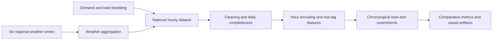

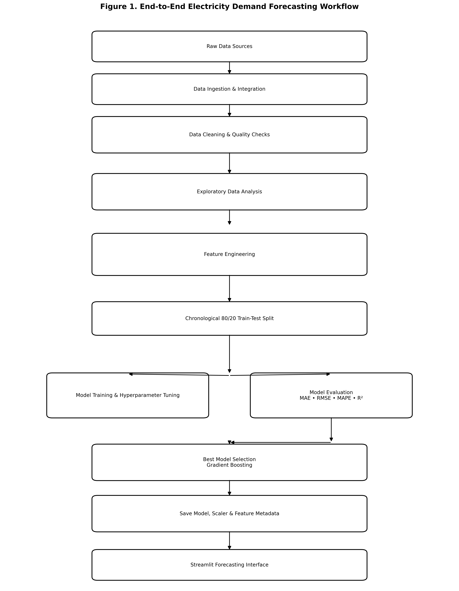

*Figure 1. End-to-end project workflow: data integration, preprocessing, feature engineering, model comparison, and artifact generation.*

---

## 4. Exploratory Analysis

The historical demand profile contains both strong intraday variation and longer-term changes. The EDA plots support cycle identification and motivate time-respecting validation.

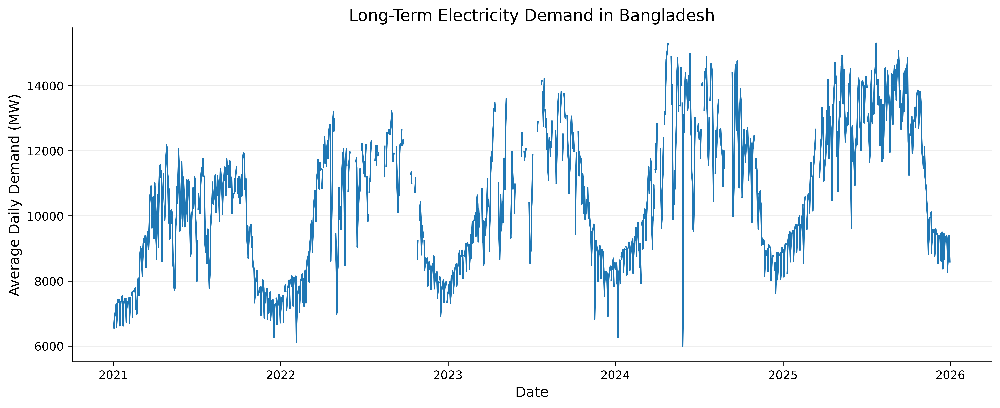

*Figure 2. National hourly electricity-demand series across the study period.*

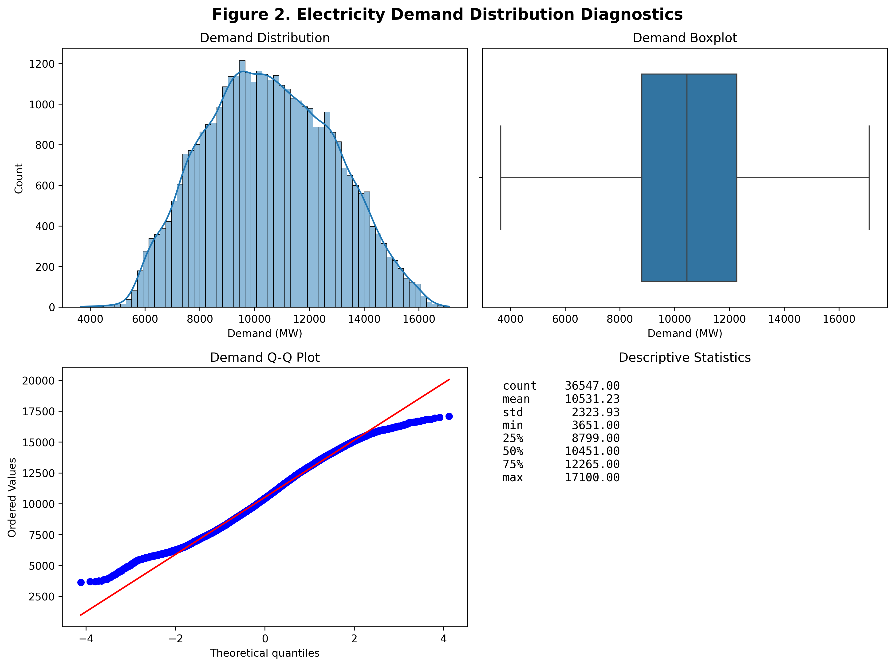

*Figure 3. Distribution of hourly demand observations.*

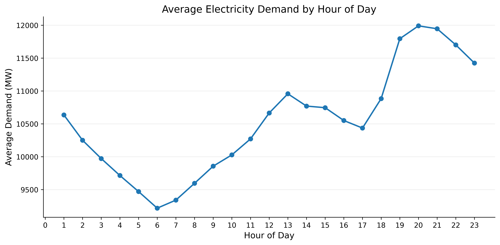

*Figure 4. Mean electricity demand for each hour of the day. The profile is a historical aggregate, not an individual forecast.*

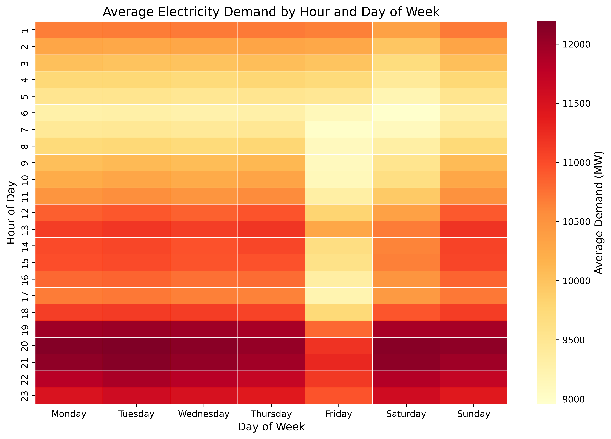

*Figure 5. Combined intraday and weekday demand patterns.*

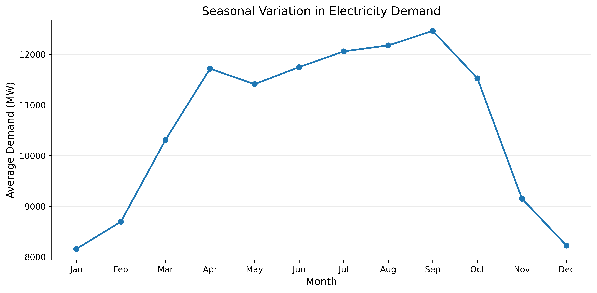

*Figure 6. Monthly average demand; it summarizes seasonal level changes in the prepared series.*

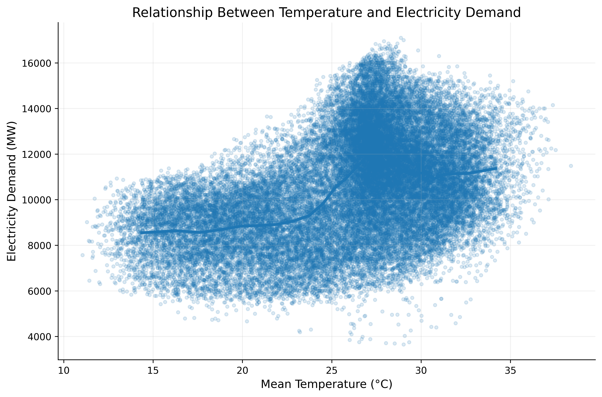

*Figure 7. Relationship between aggregated temperature and electricity demand. The figure is exploratory and does not establish causality.*

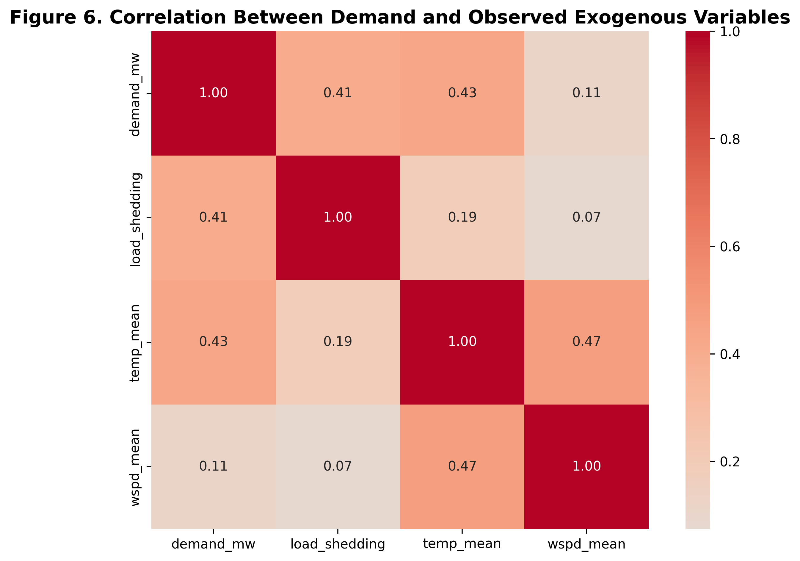

*Figure 8. Correlation diagnostics among demand, weather, lag, and time-derived variables.*

---

## 5. Forecasting Models

### 5.1 Gradient Boosting

The final notebook uses `GradientBoostingRegressor` with:

- 450 estimators;
- learning rate 0.06911732876051693;
- maximum depth 6;
- minimum samples split 8;
- minimum samples per leaf 12;
- subsample 0.6863169479272837;
- Huber loss;
- random state 42.

### 5.2 XGBoost

The final notebook uses `XGBRegressor` with the explicit configuration recorded in `model_hyperparameters.csv`, including 900 estimators, learning rate 0.046544298270924635, maximum depth 4, and regularized squared-error objective.

### 5.3 Residual ANN

The ANN is a residual MLP with dense widths 256, 256, 128, 64, and 32, GELU activations, AdamW optimization, learning rate 0.001, weight decay 0.00001, batch size 256, and 300 epochs. The training loop is not shuffled and uses MSE loss.

### 5.4 StatsForecast AutoARIMA

The final SARIMA-labeled artifact is a StatsForecast AutoARIMA fit with hourly frequency, season length 23, and six exogenous regressors: `hour_sin`, `hour_cos`, `temp_mean`, `wspd_mean`, `lag1`, and `lag23`. This matches the columns passed to AutoARIMA in `final_model.ipynb` and the saved `M_SF.pkl` artifact. The checked-in hyperparameter reference specifies:

- `max_p = 4`
- `max_q = 4`
- `max_P = 2`
- `max_Q = 2`
- `max_order = 6`
- approximation enabled

---

## 6. Experimental Design

The final model notebook uses three cumulative, chronological experiments:

| Experiment | Training and prior data | Test period |
|---:|---|---|
| 1 | 2021-01-01 to 2023-06-30 | 2023-07-01 to 2023-12-31 |
| 2 | 2021-01-01 to 2024-06-30 | 2024-07-01 to 2024-12-31 |
| 3 | 2021-01-01 to 2025-06-30 | 2025-07-01 to 2025-12-31 |

The tree-based and ANN models fit a `StandardScaler` on training features only. The holdout rows remain outside fitting and tuning for each experiment.

**AutoARIMA evaluation caveat:** the notebook builds its holdout exogenous rows from the prepared dataset, where `lag1` and `lag23` are computed from observed demand, including observations in the test window. This evaluates AutoARIMA with actual lagged-demand inputs available at each step; it is not a single fixed-origin, recursively generated six-month forecast. By contrast, the Streamlit inference path recursively constructs future lag features from predictions.

### 6.1 Evaluation metrics

- **MAE:** mean absolute prediction error, in MW;
- **RMSE:** root mean squared prediction error, in MW;
- **MAPE:** mean absolute percentage error;
- **NRMSE:** normalized root mean squared error;
- **R²:** proportion of variance explained by the model;
- **Bias:** signed mean prediction error.

Lower values are preferable for MAE, RMSE, MAPE, NRMSE, and absolute bias. R² is a regression goodness-of-fit statistic, not classification accuracy.

---

## 7. Results

The following values are direct results in `model_results_top.csv`.

| Experiment | Test period | Model | MAE (MW) | RMSE (MW) | MAPE (%) | R² | Bias (MW) |
|---:|---|---|---:|---:|---:|---:|---:|
| 1 | 2023-07-01–2023-12-31 | ANN | 185.881 | 312.974 | 1.764 | 0.9792 | 43.690 |
| 1 | 2023-07-01–2023-12-31 | Gradient Boosting | 189.379 | 321.323 | 1.800 | 0.9781 | 24.798 |
| 1 | 2023-07-01–2023-12-31 | XGBoost | 198.268 | 333.308 | 1.878 | 0.9764 | 39.874 |
| 1 | 2023-07-01–2023-12-31 | SARIMA | 322.658 | 502.374 | 3.126 | 0.9465 | 101.912 |
| 2 | 2024-07-01–2024-12-31 | ANN | 170.954 | 248.446 | 1.550 | 0.9871 | 2.201 |
| 2 | 2024-07-01–2024-12-31 | Gradient Boosting | 182.289 | 265.745 | 1.645 | 0.9853 | 22.860 |
| 2 | 2024-07-01–2024-12-31 | XGBoost | 190.031 | 270.667 | 1.712 | 0.9847 | 26.884 |
| 2 | 2024-07-01–2024-12-31 | SARIMA | 404.006 | 552.116 | 3.858 | 0.9364 | -9.799 |
| 3 | 2025-07-01–2025-12-31 | ANN | 167.569 | 239.127 | 1.414 | 0.9884 | 14.426 |
| 3 | 2025-07-01–2025-12-31 | Gradient Boosting | 181.464 | 266.434 | 1.534 | 0.9856 | 28.389 |
| 3 | 2025-07-01–2025-12-31 | XGBoost | 191.340 | 276.457 | 1.616 | 0.9845 | 44.421 |
| 3 | 2025-07-01–2025-12-31 | SARIMA | 389.011 | 562.181 | 3.548 | 0.9358 | -161.335 |

### 7.1 Comparative figures

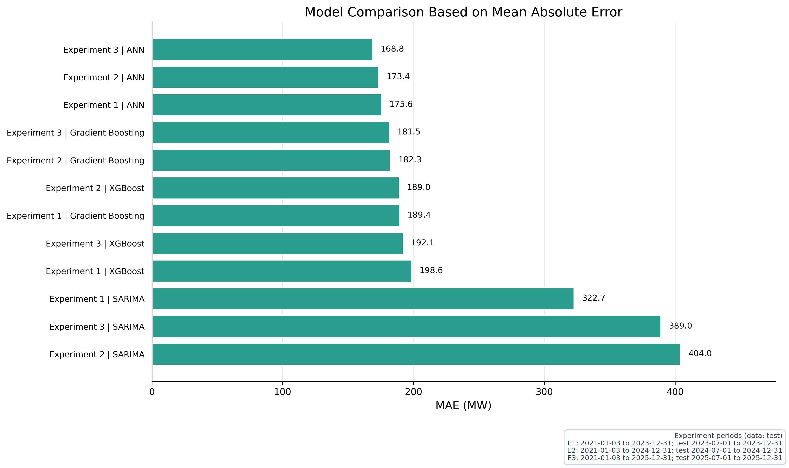

*Figure 9. MAE comparison across models and experiments. Test periods differ and must be read together with the experiment label.*

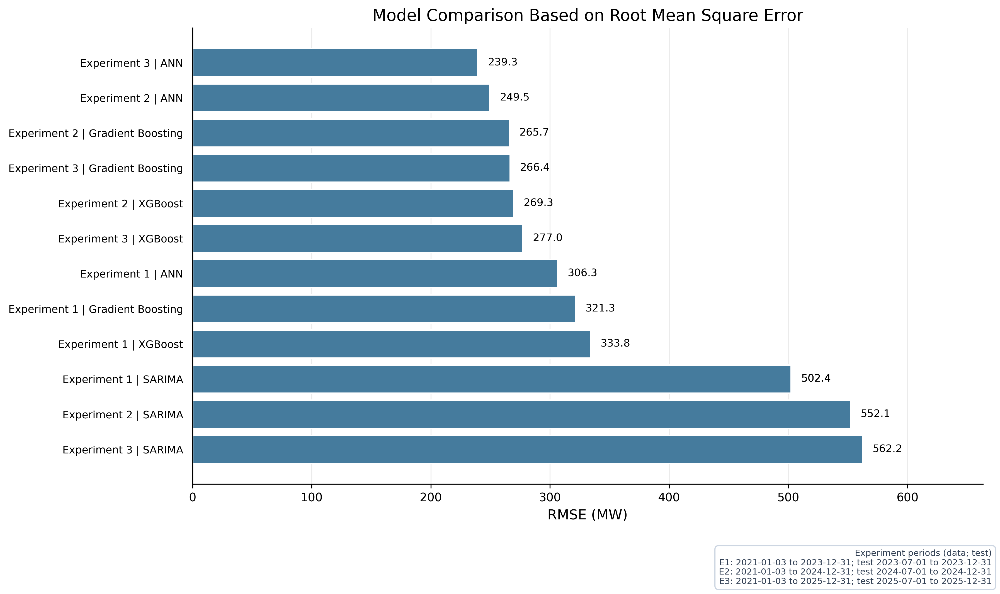

*Figure 10. RMSE comparison across models and experiments.*

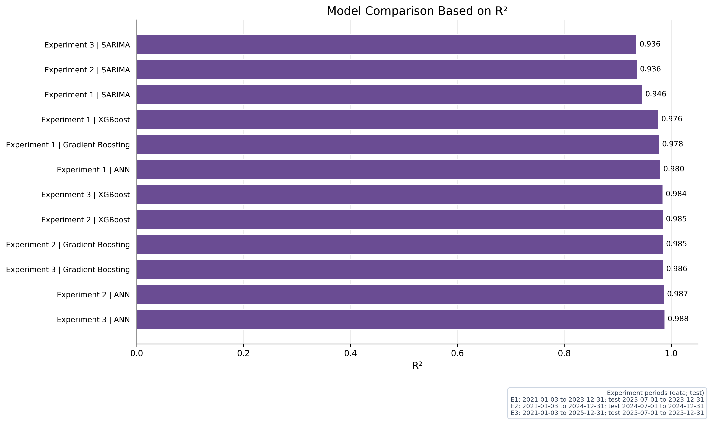

*Figure 11. R² comparison across models and experiments.*

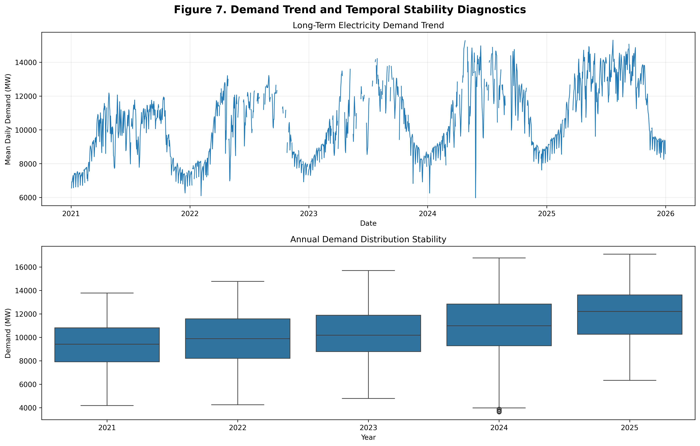

*Figure 12. Temporal stability diagnostics across the three holdout experiments.*

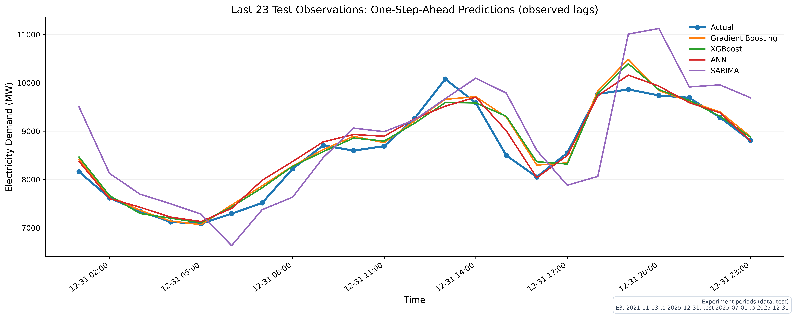

*Figure 13. Example 23-hour actual-versus-predicted demand profile from Experiment 3.*

**Do not use the current `paper_figures/Fig9_SARIMA_prediction_interval.png` as a result figure.** The checked-in image shows forecasts near zero and an interval on the order of \(10^8\) MW, which is inconsistent with the demand scale. Regenerate and validate this figure before publication.

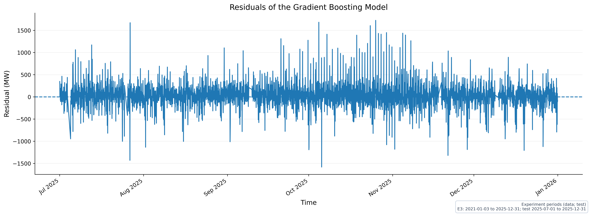

*Figure 14. Residual diagnostics for the selected model evaluation.*

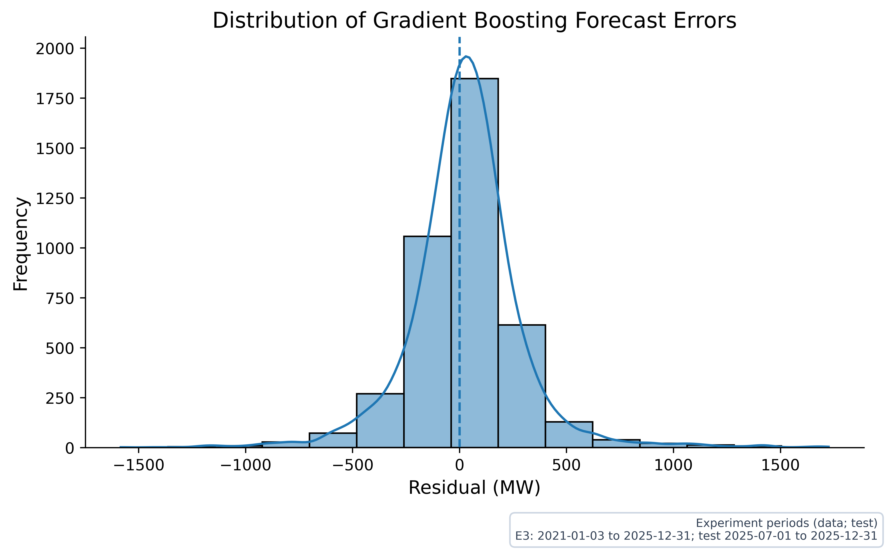

*Figure 15. Distribution of forecast residuals.*

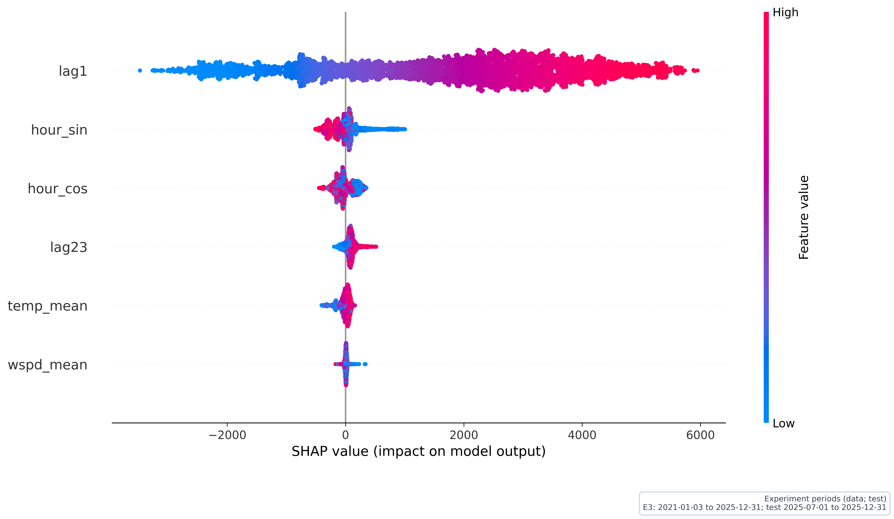

*Figure 16. Global SHAP summary for the Experiment 3 Gradient Boosting model. SHAP values indicate model contribution, not causality.*

---

## 8. Hyperparameter Tuning

The tuning notebook compares three AutoARIMA configurations on its final six-month tuning split and uses 100-trial Optuna searches for XGBoost and Gradient Boosting. In the recorded comparison, the lowest AutoARIMA RMSE was 234.456988 for `season_length = 23`, `max_p = 4`, `max_q = 4`, `max_P = 2`, `max_Q = 2`, and `max_order = 6`.

This selection score is a tuning-holdout result, not an independent final-period estimate. The final notebook separately specifies fixed configurations for full experimental evaluation.

The tuning search spaces are preserved in:

- `paper_figures/Table_hyperparameter_search_spaces.csv`
- `paper_figures/Table_hyperparameter_search_spaces.png`

---

## 9. Saved Outputs

| Path | Purpose |
|---|---|
| `cleaned_combined_data.csv` | Cleaned demand-weather dataset |
| `cleaned_min_hours_23.csv` | Modeling dataset meeting the daily completeness criterion |
| `model_results_top.csv` | Saved comparative metrics |
| `model_hyperparameters.csv` | Final explicit settings and tuning notes |
| `paper_figures/` | Publication-oriented figures |
| `saved_models/M_GBoosting.pkl` | Fitted Gradient Boosting model |
| `saved_models/M_XGBoost.pkl` | Fitted XGBoost model |
| `saved_models/M_XGBoost.json` | Portable XGBoost model |
| `saved_models/M_ANN.pth` | Fitted residual ANN weights |
| `saved_models/M_SF.pkl` | Fitted StatsForecast model |
| `saved_models/M_X_scaler.pkl` | StandardScaler |
| `saved_models/feature_name.json` | Ordered feature names |
| `saved_models/hourly_mean_demand.json` | Hourly demand fallback averages |
| `saved_models/model_metadata.json` | Targets, features, sample count, and configurations |

---

## 10. Reproducible Execution

### Environment

Use the packages in `requirements.txt`. A suitable setup is:

```bash
python -m pip install -r requirements.txt
python -m ipykernel install --user --name electricity-demand
```

Required feature families include pandas, NumPy, SciPy, scikit-learn, XGBoost, StatsForecast, Optuna, PyTorch, SHAP, Matplotlib, Seaborn, and Streamlit.

### Notebook sequence

Run the following notebooks from this directory:

1. `EDA.ipynb`
2. `Hyperparameter_tuning_of_models.ipynb`
3. `final_model.ipynb`
4. `Publication-quality.ipynb`

Several cells contain machine-specific absolute paths. Update them to the current raw data locations before rerunning. The tuning notebook is also known to contain a hard-coded `5_model` input path; change it to `cleaned_min_hours_23.csv` in this directory.

### Optional Streamlit interface

```bash
python -m streamlit run streamlit_app.py
```

The interface loads saved estimators from `saved_models/` and recursively predicts hourly values. For the tree and neural-network artifacts, future lag values are earlier model predictions rather than observed demand.

See `STREAMLIT_GUIDE.md` for interface instructions and limitations.

---

## 11. Limitations

- The reported demand may be supply-constrained during load-shedding periods and is not necessarily latent electricity demand.
- Three holdout windows provide temporal evidence but do not replace an independently observed future test set.
- Model rankings vary between periods; no ranking should be generalized beyond the recorded windows.
- Lag features are row-based and may be unreliable if timestamps contain gaps.
- Daily completeness filtering is not the same as a guaranteed continuous hourly series.
- Future weather and demand-lag inputs must be known or forecast; using end-of-period observed values for future forecasts would introduce leakage.
- AutoARIMA holdout scores use observed test-period lag regressors; they are not equivalent to a fixed-origin multi-step forecast using recursively predicted lags.
- The currently saved AutoARIMA prediction-interval figure is numerically implausible and must be regenerated before it is interpreted or published.
- The ANN and tree artifacts require the exact saved scaler and ordered feature list.
- Publication figures and saved artifacts reflect a particular package environment and dataset state. Re-run and record package versions for exact reproduction.

---

## 12. Project Documentation

- [`WORKFLOW.md`](WORKFLOW.md): end-to-end methodology and execution procedure
- [`project_diagram.md`](project_diagram.md): detailed Mermaid process diagram
- [`STREAMLIT_GUIDE.md`](STREAMLIT_GUIDE.md): deployment and interface use
- [`final_model.ipynb`](final_model.ipynb): primary model implementation
- [`Hyperparameter_tuning_of_models.ipynb`](Hyperparameter_tuning_of_models.ipynb): tuning implementation
- [`Publication-quality.ipynb`](Publication-quality.ipynb): export and publication figure preparation

