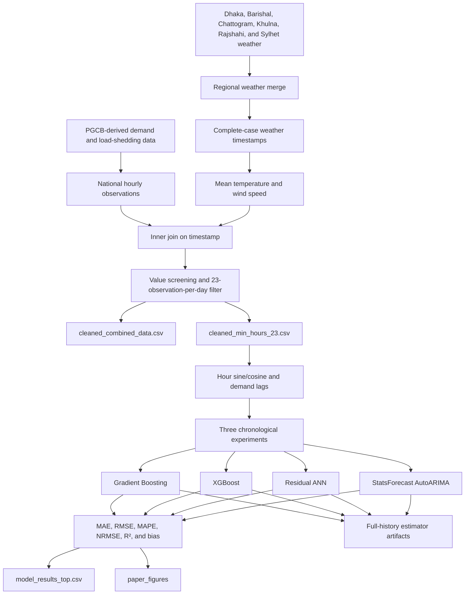
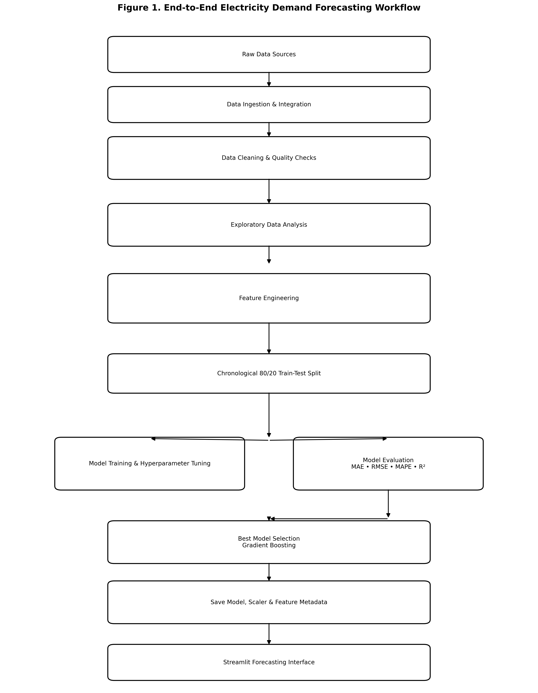

# Research Workflow and Reproducibility Protocol

This document describes the implemented methodology for the hourly electricity-demand forecasting project. Notebook code is the executable source of truth; this protocol records the intended sequence and evidence-preserving checks.

## 1. Study Architecture





*Figure W1. Project workflow from raw domains to evaluation and saved artifacts.*

---

## 2. Phase I — Data Preparation

### 2.1 Run `EDA.ipynb`

1. Load the PGCB-derived demand/load-shedding CSV.
2. Load hourly CSV files for Dhaka, Barishal, Chattogram, Khulna, Rajshahi, and Sylhet.
3. Rename each region's temperature and wind-speed columns.
4. Outer-merge regional weather tables on `time`.
5. Remove rows missing regional weather values.
6. Calculate row-wise mean temperature and mean wind speed.
7. Merge the weather means with national demand/load shedding.
8. Apply data-screening thresholds.
9. Require at least 23 observations for each retained day.
10. Export prepared datasets and exploratory figures.

### 2.2 Checked-in data results

| File | Rows | Time range |
|---|---:|---|
| `merged_all_divisions_weather_data.csv` | 45,697 | 2020-01-01 00:00 to 2025-12-31 23:00 |
| `cleaned_combined_data.csv` | 42,611 | 2020-01-01 03:00 to 2025-12-31 23:00 |
| `cleaned_min_hours_23.csv` | 36,547 | 2021-01-02 01:00 to 2025-12-31 23:00 |

### 2.3 Screening and quality checks

Before rerunning, record:

- source file paths and checksums;
- raw, weather-matched, screened, and complete-case row counts;
- first and last timestamps;
- duplicate timestamps;
- missing timestamps relative to an hourly index;
- weather and target distributions before and after filtering.

The notebook removes:

- `demand_mw < 3500`;
- `demand_mw > 20000`;
- `load_shedding > 1500`;
- `wspd_mean > 30`.

These are reproducibility rules for this project, not universal physical thresholds.

### 2.4 Data limitations

- The demand variable describes recorded demand and may be constrained by load shedding.
- Weather represents national averages based on selected divisions, not a spatially balanced grid average.
- Inner joining and complete-case filtering can omit timestamps.
- Rangpur appears in the EDA station narrative but is not included in the checked-in six-region merge code.

---

## 3. Phase II — Feature Engineering

Create the following variables in the modeling notebooks:

| Feature | Definition | Modeling role |
|---|---|---|
| `hour_sin` | Cyclic sine encoding of hour | Intraday cycle |
| `hour_cos` | Cyclic cosine encoding of hour | Intraday cycle |
| `temp_mean` | Nationwide mean temperature | Exogenous weather |
| `wspd_mean` | Nationwide mean wind speed | Exogenous weather |
| `lag1` | Previous demand row | Short-term memory |
| `lag23` | Demand row 23 positions earlier | Longer local memory |

Sort by timestamp before lag construction. Remove initial lag-null rows. The metadata reports 36,524 usable rows after this process.

**Leakage control:** lag values must be constructed only from known or previously observed demand. Recursive forecasts replace future lag values with earlier forecast outputs, so forecasts farther into the horizon depend increasingly on simulated history.

**Cadence control:** use `lag23` as a row index unless timestamp regularity is verified. The daily completeness filter does not prove that every day is continuous.

---

## 4. Phase III — Hyperparameter Tuning

### 4.1 Run `Hyperparameter_tuning_of_models.ipynb`

Update machine-specific data paths before running. The notebook currently references a CSV under `5_model`; point it to `7_model/cleaned_min_hours_23.csv`.

### 4.2 AutoARIMA

The tuning notebook compares three configurations at seasonal length 23 on its final six-calendar-month test segment:

| Search size | `max_p` | `max_q` | `max_P` | `max_Q` | `max_order` |
|---|---:|---:|---:|---:|---:|
| 2 | 2 | 2 | 1 | 1 | 3 |
| 3 | 3 | 3 | 2 | 2 | 5 |
| 4 | 4 | 4 | 2 | 2 | 6 |

The broadest search recorded the lowest tuning RMSE of 234.456988.

### 4.3 Gradient Boosting and XGBoost

The Optuna searches conduct 100 trials and minimize validation RMSE. The validation tail is the final 20% of the training segment, without shuffling:

```text
training portion → chronological candidate validation → holdout test
```

The tuning search is not the final experimental fit. Explicit final configurations are stored in `model_hyperparameters.csv`.

---

## 5. Phase IV — Chronological Model Evaluation

### 5.1 Run `final_model.ipynb`

The experiment boundaries are:

| Experiment | Dataset | Test period |
|---:|---|---|
| 1 | 2021-2023 | 2023-07-01 to 2023-12-31 |
| 2 | 2021-2024 | 2024-07-01 to 2024-12-31 |
| 3 | 2021-2025 | 2025-07-01 to 2025-12-31 |

For each experiment:

1. select data through the end of the test year;
2. construct the six features and target;
3. fit the StandardScaler on training features;
4. transform training and test features;
5. fit each model on training data only;
6. predict the final six calendar months;
7. calculate regression metrics;
8. retain the experiment identifier with every result.

**AutoARIMA evaluation caveat:** the notebook constructs holdout exogenous rows from the prepared full dataset, including `lag1` and `lag23` derived from observed demand in the test period. Therefore, its AutoARIMA scores use actual lagged-demand values at each step and do not represent a fixed-origin, recursively generated six-month forecast. The Streamlit inference path instead recursively feeds its own predictions into future lag features.

### 5.2 Candidate models

| Model | Key implementation |
|---|---|
| Gradient Boosting | `sklearn.ensemble.GradientBoostingRegressor` |
| XGBoost | `xgboost.XGBRegressor` |
| Residual ANN | PyTorch residual MLP |
| AutoARIMA | StatsForecast `AutoARIMA`, seasonal length 23 |

The tree, ANN, and saved AutoARIMA model receive all six features. For AutoARIMA, the exogenous regressors are `hour_sin`, `hour_cos`, `temp_mean`, `wspd_mean`, `lag1`, and `lag23`; this matches `final_model.ipynb` and the saved `M_SF.pkl` artifact.

### 5.3 Metrics

Compute:

- mean absolute error;
- root mean squared error;
- mean absolute percentage error;
- normalized RMSE;
- coefficient of determination;
- mean signed bias.

Optional diagnostics include stress-period and load-shedding analysis. Keep these secondary to exact period-specific metrics.

---

## 6. Phase V — Results and Interpretation

### 6.1 Saved holdout results

| Experiment | Lowest-MAE model | MAE (MW) | RMSE (MW) | R² |
|---:|---|---:|---:|---:|
| 1 | ANN | 185.881 | 312.974 | 0.9792 |
| 2 | ANN | 170.954 | 248.446 | 0.9871 |
| 3 | ANN | 167.569 | 239.127 | 0.9884 |

The complete ranking and bias values are in `model_results_top.csv`. The same model is not always tested on the same dates across experiments, so do not compare a metric from two experiments without noting the period.

### 6.2 Core result figures

| Figure | Purpose |
|---|---|
| `Fig7A_MAE_comparison.png` | MAE ranking |
| `Fig7B_RMSE_comparison.png` | RMSE ranking |
| `Fig7C_R2_comparison.png` | R² comparison |
| `Fig7_temporal_stability_diagnostics.png` | Stability across experiments |
| `Fig8_actual_vs_predicted_23h.png` | Example forecast trajectory |
| `Fig10_residuals.png` | Residual pattern |
| `Fig11_residual_distribution.png` | Residual distribution |
| `Fig12_SHAP_global.png` | Gradient Boosting feature contribution |

---

## 7. Phase VI — Save Reusable Artifacts

### 7.1 Export targets

Create or refresh:

- `M_GBoosting.pkl`
- `M_XGBoost.pkl`
- `M_XGBoost.json`
- `M_ANN.pth`
- `M_SF.pkl`
- `M_X_scaler.pkl`
- `feature_name.json`
- `hourly_mean_demand.json`
- `model_metadata.json`
- `model_results_top.csv`
- `model_hyperparameters.csv`

### 7.2 Synchronization checks

Before publishing a revised model set:

- confirm that `feature_name.json` contains exactly the six deployed features;
- confirm that the scaler was fitted to those features;
- confirm that the ANN architecture matches `M_ANN.pth`;
- confirm that the SARIMA `_exog` feature set is exactly `hour_sin`, `hour_cos`, `temp_mean`, `wspd_mean`, `lag1`, and `lag23`;
- confirm that each model file is loadable by `forecast_engine.py`;
- confirm that saved metric values match `model_results_top.csv`;
- record package versions and the training data range.

---

## 8. Phase VII — Publication Figures

Run `Publication-quality.ipynb` after the model and EDA notebooks. The notebook prepares figures under `paper_figures/`.

Recommended reporting set:

1. `Fig1_workflow.png` — analytical workflow;
2. `Fig1_long_term_demand.png` — demand series;
3. `Fig2_hourly_demand_profile.png` — intraday profile;
4. `Fig3_hour_day_heatmap.png` — weekly and hourly pattern;
5. `Fig5_temperature_demand.png` — weather-demand relationship;
6. `Fig6_feature_correlation_diagnostics.png` — feature diagnostics;
7. `Fig7A_MAE_comparison.png` through `Fig7F_Bias_comparison.png` — model comparison;
8. `Fig8_actual_vs_predicted_23h.png` — forecast example;
9. `Fig10_residuals.png` and `Fig11_residual_distribution.png` — residual validation;
10. `Fig12_SHAP_global.png` — model interpretation.

The current `Fig9_SARIMA_prediction_interval.png` is not publication-ready: its forecast is near zero and its interval is on the order of \(10^8\) MW, inconsistent with the demand scale. Regenerate and validate it before use. Other figures should include readable labels, units, exact test periods, and direct links to the corresponding metric table.

---

## 9. Phase VIII — Optional Interactive Inference

Launch:

```bash
python -m streamlit run streamlit_app.py
```

The application:

- loads the saved AutoARIMA, Gradient Boosting, XGBoost, and ANN artifacts;
- uses the latest saved model history to determine the forecast start;
- accepts temperature, wind speed, and last-hour demand;
- forecasts intermediate hours recursively;
- reports AutoARIMA 80% and 90% intervals;
- labels result periods using the latest record in `model_results_top.csv`.

Limitations:

- The non-SARIMA artifacts do not record their own full training cutoff in the current metadata;
- `hourly_mean_demand.json` supplies fallback demand only;
- recursive predictions become less directly grounded as the forecast horizon grows;
- future weather must be forecast or assumed;
- prediction intervals are unavailable for tree and neural-network artifacts.

---

## 10. Reproducibility Checklist

- [ ] Raw source paths verified.
- [ ] Dataset counts and date ranges recorded.
- [ ] Duplicate or missing timestamps audited.
- [ ] Scaling fitted only on training observations.
- [ ] Lag features created only from prior rows.
- [ ] Test periods remain chronological and untouched.
- [ ] Tuning holdout separated from final test holdout.
- [ ] AutoARIMA metrics identified as using observed holdout lag regressors, not a fixed-origin recursive forecast.
- [ ] Reported values match `model_results_top.csv` and include the experiment number and exact test period.
- [ ] Saved models match feature names and scaler.
- [ ] Package versions recorded.
- [ ] Figures regenerated from the same data state.
- [ ] Claims distinguish model association from causal inference.
